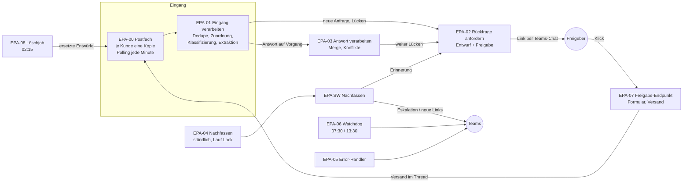
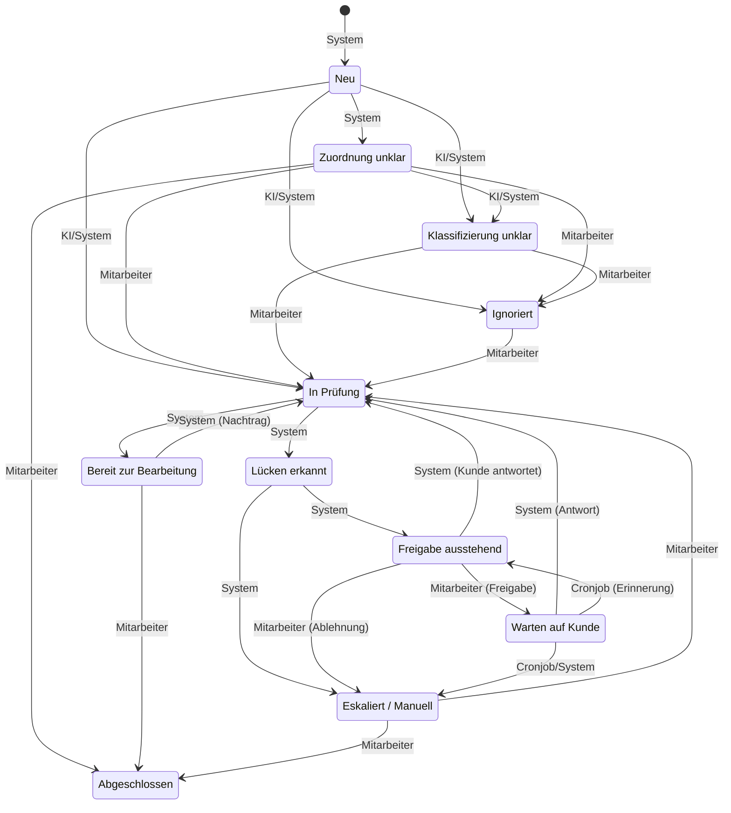

# Architektur: Email Process Agent

Stand 2026-10-14 (M7). n8n 2.43.4, Speicher n8n Data Tables, KI OpenAI, Microsoft 365 (Outlook, Teams).

## 1. Workflows im Überblick

**Sub-Workflows (Bausteine):** EPA SW Config laden, SW Vorgang verwalten, SW Status setzen (mit Statusmatrix), SW Audit schreiben, SW LLM aufrufen, SW Benachrichtigen (Kanal), SW Freigabe senden (1:1-Chat), SW Nachfassen. Alle Workflows melden Abbrüche an EPA-05.

**Datenhaltung (Data Tables):**

| Tabelle | Zweck |
|---|---|
| `epa_config_allgemein` | Config je Kunde |
| `epa_config_pflichtfelder` | Pflichtfelder und Textbausteine je Kunde |
| `epa_vorgaenge` | Vorgänge, mit Version für Compare-and-Set |
| `epa_audit_log` | Audit-Log |
| `epa_fehler_log` | Fehlerlog |
| `epa_verarbeitete_mails` | Dedupe |
| `epa_prompts` | Prompts (versioniert, mit Prüfsumme) |
| `epa_freigaben` | Freigaben |
| `epa_freigabe_tokens` | Freigabe-Links (nur SHA-256-Hashes) |
| `epa_system_status` | Lauf-Lock, Heartbeats |

## 2. Statusmodell
Quelle der Wahrheit ist `src/statusMatrix.js`; jeder andere Übergang wird mit 409 abgelehnt. Zusätzlich darf der Error-Handler (Auslöser „System“) jeden laufenden Vorgang auf „Eskaliert / Manuell“ setzen.

## 3. Sicherheitsprinzipien
- **Kein Versand ohne Freigabe:** Jede Mail an Kunden ist ein Entwurf im Postfach. Gesendet wird erst nach Klick eines berechtigten Freigebers, und zwar genau einmal (atomare Übernahme, Suche in „Gesendete Elemente“ bei Unsicherheit).
- **KI ohne Werkzeuge:** Die KI liefert nur JSON nach Schema (Klassifizierung, Extraktion, Hülle der Rückfrage). Mail-Inhalte sind Daten in einem abgegrenzten Block, nie Anweisungen. Code prüft und entscheidet. Die festen Textbausteine, die Signatur und der KI-Hinweis werden deterministisch eingesetzt.
- **Nichts löschen, was unklar ist:** Eingegangene Mails werden nie gelöscht. Standardmäßig bleiben auch aussortierte Mails im Posteingang; nur mit gesetztem `archivordner` werden sie dorthin verschoben. Der Löschjob entfernt nur abgeschlossene Daten nach Frist und nur nachweislich eigene, ersetzte Entwürfe.
- **Datenminimierung in Logs:** Fehlerlog und Statuszeilen enthalten nur IDs, Codes und technische Meldungen (E-Mail-Adressen und Nummern werden maskiert).
- **Concurrency:** Versionsfeld mit bedingtem Update (Compare-and-Set) für Vorgänge, Freigaben und den Lauf-Lock.

## 4. Code-Organisation
| Ordner | Inhalt |
|---|---|
| `src/` | Fachlogik als reine JS-Module mit Unit-Tests (werden beim Build in die Code-Nodes eingebettet) |
| `workflows-src/datatable/` | Workflow-Definitionen als Code (Generator) |
| `workflows/` | erzeugte, importierbare n8n-JSON-Dateien (nicht von Hand ändern) |
| `prompts/v1/` | Systemprompts (versioniert) |
| `config/` | Data-Table-Schema, Beispiel-Config, leere Vorlage, CSV-Vorlagen |
| `tools/` | Build, Strukturprüfung, Deploy, Setup, End-to-End-Tests mit Mock-LLM/-Graph |
| `docs/` | Bauplan, Inbetriebnahme, Betriebshandbuch, Checklisten, Testprotokolle, Berichte |

Die Postgres-Variante (`workflows-postgres/`) ist auf dem Stand von M1 geblieben, seit der Entscheidung für Data Tables (siehe Grenzen und Risiken).
