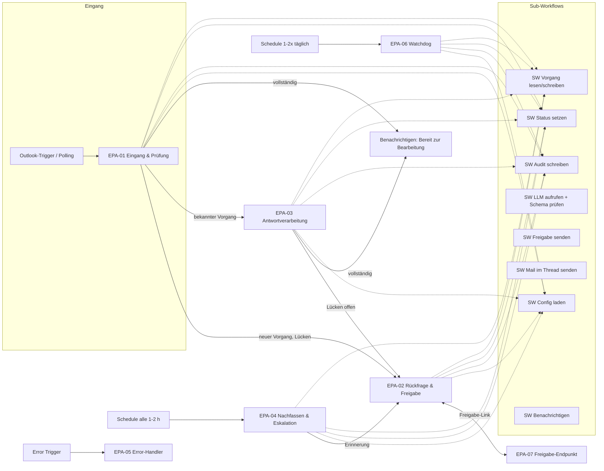
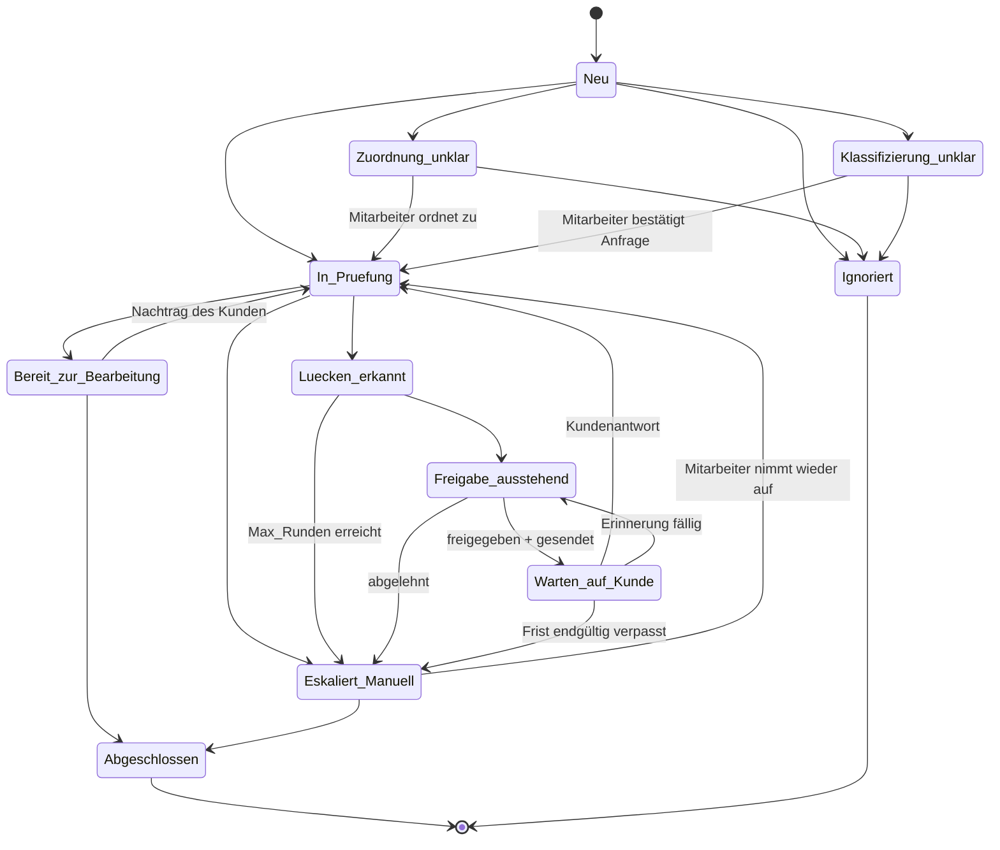

# Config-Driven Email Process Agent – M0: Klärung und Bauplan

| | |
|---|---|
| Projekt | Config-Driven Email Process Agent (EPA) für TIM Agent Systems |
| Meilenstein | **M0 – Klärung und Plan** (es wird noch nichts gebaut) |
| Stand | 2026-10-13, v0.3: F1, F3, F4, F5, F6 beantwortet; M1 umgesetzt (siehe M1-Bericht.md) |
| Status | M0 abgeschlossen; offene Fragen F7–F12 mit Default-Annahmen |

Legende: **[Entscheidung]** = von mir vorgeschlagen, durch "Go" bestätigt; **[Frage]** = brauche ich von dir; **[zu verifizieren]** = Annahme, die ich vor dem Bau gegen Doku bzw. die laufende n8n-Instanz prüfe.

---

## 1. Offene Fragen (gebündelt)

Zu jeder Frage steht mein Vorschlag. Wenn du einem Vorschlag zustimmst, reicht "ok".

| # | Frage | Mein Vorschlag / Default |
|---|---|---|
| F1 | n8n Cloud oder self-hosted, welche Version? Ist die Instanz aktiv? (Im Repo liegt eine Übergabe für `timbaule.app.n8n.cloud`, dort war der Testzeitraum abgelaufen.) | **Beantwortet:** n8n Cloud, `https://timbaule.app.n8n.cloud`, Version 2.43.4. |
| F2 | n8n-MCP-Server: In dieser Sitzung ist der n8n-MCP-Server vorhanden, aber **nicht autorisiert**. | In den claude.ai-Connector-Einstellungen autorisieren. Sonst liefere ich JSON-Dateien und eine Import-Anleitung. |
| F3 | Welcher LLM-Anbieter darf genutzt werden (EU-Region, AVV/DPA)? Welche Keys gibt es? Ein OpenAI-Credential existiert bereits. | **Beantwortet: OpenAI.** Das vorhandene n8n-Credential `OpenAI account` wird genutzt. Für DSGVO empfohlen: ein eigenes OpenAI-Projekt mit EU-Datenresidenz und Zero-Data-Retention, sofern für deinen Account verfügbar, plus abgeschlossene AVV (DPA) mit OpenAI [zu verifizieren: Voraussetzungen im OpenAI-Dashboard]. Modellnamen (kleines Modell für Klassifizierung, stärkeres für Extraktion) stehen in der Config; die verfügbaren Modelle prüfe ich beim Bau in der Instanz. Der Anbieter bleibt hinter `SW LLM aufrufen` austauschbar. |
| F4 | Microsoft: Gibt es Testpostfach, Teams-Kanal und SharePoint-Site? Wer kann Admin-Consent erteilen? Ist das Postfach ein Shared Mailbox oder ein Benutzerpostfach? | **Beantwortet:** vorhanden. Nodes werden ohne Credentials gebaut; Zuweisung erfolgt in n8n. |
| F5 | Freigabe in Teams: Gibt es einen Bot oder Power-Automate-Premium-Lizenzen? | **Beantwortet:** Variante **B**. |
| F6 | Datenspeicher: Bleibt Excel dauerhaft, oder planen wir Postgres ein? | **Beantwortet: Postgres.** |
| F7 | Erster Referenz-Anwendungsfall? | Transportanfrage (Felder siehe 4.8). Bitte Felder, Pflicht/optional und Textbausteine bestätigen. |
| F8 | Du oder Sie? Gibt es einen KI-Hinweistext? | „Sie“. Entwurf: „Diese Nachricht wurde KI-gestützt vorbereitet und von einem Mitarbeiter geprüft und freigegeben.“ **Muss juristisch geprüft werden.** |
| F9 | Geschäftszeiten, Feiertage (welches Bundesland?), Fristen | Mo–Fr 08:00–17:00 Europe/Berlin, Feiertage NRW, Antwortfrist 48 Geschäftsstunden, `Max_Runden` = 3, 2 Erinnerungen im Abstand von 24 Geschäftsstunden, Freigabe-Erinnerung nach 4 h. |
| F10 | Anhänge: Dürfen Bilder bzw. Scans an ein Vision-LLM gehen, oder soll OCR separat laufen? | PDF mit Textlayer: Text lokal extrahieren (n8n „Extract from File“). Scans und Fotos: **Azure AI Document Intelligence (EU-Region)** für OCR, danach Text an das LLM. Vision-LLM nur als Option. Limits: 10 MB je Anhang, 25 MB je Mail, Typen PDF/JPG/PNG/TIFF/DOCX. |
| F11 | Ablageort: Ich lege alles in diesem Repository unter `email-process-agent/` ab, getrennt vom bestehenden „AI Office Assistant“. Ok? | Ja. Das bestehende Projekt bleibt unverändert. |
| F12 | Wer darf freigeben? Pro Kunde eine Liste von Freigeber-E-Mails (Entra-UPN)? | Ja, `Freigeber` in `Config_Allgemein` als Liste. Zusätzlich ein Vertreter. |

---

## 2. Architekturübersicht

### 2.1 Workflows



| ID | Workflow | Trigger | Aufgabe |
|---|---|---|---|
| EPA-01 | Eingang & Prüfung | Microsoft Outlook Trigger (Polling) | A1–A4, B1–B5 |
| EPA-02 | Rückfrage & Freigabe | Execute Workflow | C1–C4 und Erinnerungsversand aus E |
| EPA-03 | Antwortverarbeitung | Execute Workflow | Phase D |
| EPA-04 | Nachfassen & Eskalation | Schedule | Phase E |
| EPA-05 | Error-Handler | Error Trigger | Phase F (Fehlerklasse, Log, Alarm, Vorgang sichern) |
| EPA-06 | Watchdog | Schedule | Phase F (Tokens, APIs, Stille, hängende Vorgänge, Heartbeats) |
| EPA-07 | Freigabe-Endpunkt | Webhook + n8n Form | Token prüfen, Freigeben/Bearbeiten/Ablehnen, wartenden Ablauf fortsetzen |

Sub-Workflows (alle mit typisierten Eingaben, „Define Below“, verb-first benannt):

| Sub-Workflow | Zweck | Adapter-Grenze |
|---|---|---|
| `SW Config laden` | Config pro Postfach/Kunde laden, validieren, bei Fehler harter Abbruch | Speicher |
| `SW Vorgang lesen/schreiben` | Einziger Zugriff auf `Vorgaenge`, mit Versionsprüfung | Speicher (Excel ↔ Postgres) |
| `SW Status setzen` | Prüft Übergangsmatrix, schreibt Status und Audit, 409 bei unzulässigem Übergang | – |
| `SW Audit schreiben` | Append-only in `Audit_Log` | Speicher |
| `SW LLM aufrufen` | Prompt aus Prompt-Registry, Modellparameter aus Config, Schema-Validierung, 1 Korrektur-Retry, sonst 422 | LLM-Anbieter |
| `SW Freigabe senden` | Freigabe anlegen (Token), Karte an Freigeber senden | Kanal (Teams ↔ Slack) |
| `SW Mail im Thread senden` | Entwurf als Reply im Thread erzeugen und idempotent senden | Mail (Graph ↔ Gmail) |
| `SW Benachrichtigen` | Info-/Alarmnachrichten an Kanal oder Person | Kanal (Teams ↔ Slack) |

Damit betreffen ein Wechsel auf Gmail, Slack oder Postgres nur die Adapter-Sub-Workflows, nicht den Kern.

### 2.2 Statusmodell und Übergangsmatrix



Die Matrix liegt als eine Datei (`src/statusMatrix.js`) vor und wird in den Code-Node von `SW Status setzen` eingebettet. Jeder andere Übergang wirft `409 UNZULAESSIGER_STATUSWECHSEL`. Von jedem Status außer `Abgeschlossen` und `Ignoriert` ist zusätzlich `Eskaliert / Manuell` durch den Error-Handler erlaubt. **[Entscheidung]** Die Erinnerung läuft über `Freigabe_ausstehend`, damit auch Erinnerungen ohne Freigabe nie rausgehen. Ein Unterfeld `Freigabe_Art` (Rueckfrage/Erinnerung) unterscheidet die beiden Fälle.

---

## 3. Technische Standards (Umsetzung)

| Standard | Umsetzung |
|---|---|
| Retries | `retryOnFail`, `maxTries` 3, `waitBetweenTries` 2000–5000 ms auf allen Graph-, LLM- und Teams-Nodes. Bei 4xx (außer 408/429) wird nicht wiederholt: HTTP-Request-Nodes mit „Never Error“ + Code-Weiche, damit 4xx direkt in den Fehlerpfad geht. 429 mit `Retry-After` wird im Code beachtet. [zu verifizieren: ob `retryOnFail` bei 4xx in der Instanzversion zwischen Codes unterscheidet. Falls nicht, Retry-Schleife im Code.] |
| Fehlerbehandlung | `onError: continueErrorOutput` an kritischen Nodes, Fehlerausgang → `Fehler klassifizieren` → Statusmapping → `Stop and Error` mit strukturiertem Fehlerobjekt. EPA-05 ist in **allen** Workflows als Error Workflow gesetzt. |
| Statuscode-Mapping | 400 Format, 401/403 Auth, 404 Vorgang/Mail fehlt, 409 Duplikat/Konflikt/Statusübergang/Versionskonflikt, 410 Freigabe abgelaufen, 422 Extraktion/Schema, 424 Konfigurationsfehler (z. B. fehlender Textbaustein), 429 Rate-Limit, 502/503/504 Upstream. Zentral definiert in `src/fehlerklassen.js`. |
| Idempotenz | Tabelle `Verarbeitete_Mails` mit `internetMessageId` als Schlüssel (in Postgres `UNIQUE`). Ausgehende Mails: Entwurf wird vor der Freigabe erzeugt, seine ID gespeichert, nach Freigabe genau dieser Entwurf gesendet (siehe 5.4). |
| Concurrency | Feld `Version` + `Lock_Bis`/`Lock_Durch` in `Vorgaenge`. Schreiben nur mit erwarteter Version. Postgres: atomar `UPDATE … WHERE version = $n`. Excel: Restrisiko, siehe 4.7. Cronjob: eigener Lauf-Lock in `System_Status`. |
| Datenschutz in Logs | Fehler-Log nur IDs, Node, Execution-ID, Statuscode, technische Meldung. Mail-Inhalte nie in Logs. Audit-Merge-Einträge enthalten Feldwerte (notwendig für Nachvollziehbarkeit) und unterliegen der Löschfrist. |
| Zeit | Luxon (`DateTime` im Code-Node), Zeitzone aus Config, Geschäftszeiten und Feiertage aus Config. Fristberechnung als reine Funktion mit Unit-Tests. |
| Dokumentation | Sticky Note je Workflow (Zweck, Trigger, Ein- und Ausgaben), deutsche, sprechende Node-Namen. |

**Code-Organisation:** Die Logik der Code-Nodes wird als reine JS-Module in `src/` geschrieben und mit `node:test` getestet (ohne zusätzliche Abhängigkeiten). Ein Build-Skript (`tools/build-workflows.js`) bettet die Module in die Code-Nodes der Workflow-JSONs ein. n8n Cloud erlaubt im Code-Node kein `require` lokaler Dateien, daher wird eingebettet statt importiert. So testen die Tests genau den Code, der in n8n läuft.

---

## 4. Datenmodell

### 4.1 `Vorgaenge`
Wie im Masterprompt (4.1), ergänzt um:

| Zusatzfeld | Zweck |
|---|---|
| `Kunde_ID` | Mandantenfeld, Pflicht in jeder Abfrage |
| `Vorgangstyp` | wählt die Pflichtfeld-Matrix |
| `Version` (int), `Lock_Bis`, `Lock_Durch` | Concurrency |
| `Bekannte_Message_IDs_JSON` | alle ein- und ausgehenden `internetMessageId`s für die Zuordnung über In-Reply-To/References |
| `Konflikte_JSON` | offene Datenkonflikte aus Phase D |
| `Freigabe_ID_Aktuell` | Verweis auf die laufende Freigabe |
| `Spoofing_Hinweis` | Ergebnis der Header-Basisprüfung (SPF/DKIM/DMARC aus `Authentication-Results`) |
| `Loeschen_Ab` | aus der Aufbewahrungsfrist berechnet |

`Vorgangs_ID`: `V-JJJJ-NNNN`. Der Zähler kommt aus `System_Status` (Postgres: Sequence pro Jahr).

### 4.2 `Config_Pflichtfelder`
Wie im Masterprompt, plus `Kunde_ID`, `Vorgangstyp`, `Aktiv`, `Platzhalter_Muster` (optional, ergänzt die globale Platzhalterliste) und `Extraktions_Hinweis` (kurze Feldbeschreibung für das LLM-Schema).

### 4.3 `Config_Allgemein`
Wie im Masterprompt, plus `Freigeber` (Liste), `Vertreter`, `Konfidenz_Schwelle_Klassifizierung` (Default 0,75), `LLM_Profil` (Modell, Temperatur 0–0,2, Timeout, Max-Tokens je Aufgabe), `Prompt_Versionen`, `Frist_nur_Geschaeftszeit` (bool), `Feiertage_Region`, `Archivordner`, `Aufbewahrung_Tage`, `Anhang_Limits`, `Leerantwort_Fristverlaengerung_Stunden`, `Freigabe_Erinnerung_Stunden`, `Freigabe_Ablauf_Stunden`.

### 4.4 `Audit_Log` (append-only)
`Zeitstempel | Kunde_ID | Vorgangs_ID | Typ (STATUS/MERGE/FREIGABE/ZUORDNUNG/SYSTEM) | Alt -> Neu | Ausloeser | Details | Referenz (Mail-ID/Execution-ID)`. In Postgres per Rechteentzug gesichert: kein UPDATE oder DELETE für die n8n-Rolle, außer für den Löschjob.

### 4.5 Zusätzliche Tabellen
| Tabelle | Zweck |
|---|---|
| `Verarbeitete_Mails` | Dedupe (`internetMessageId`, Kunde, Zeitpunkt, Ergebnis) |
| `Freigaben` | `Freigabe_ID`, `Vorgangs_ID`, `Token_Hash` (SHA-256), `Freigeber`, `Ablauf`, `Verbraucht_Am`, `Entscheidung`, `Bearbeitet` (bool), `Entwurf_Message_ID`, `Resume_Ref` |
| `Fehler_Log` | Fehlerklasse, Statuscode, Workflow, Node, Execution-ID, Vorgangs_ID, Meldung ohne Inhalte |
| `System_Status` | Heartbeats (Cronjob, Watchdog), Zähler, Lauf-Locks, Zeitpunkt der letzten Mail je Postfach |
| `Config_Feiertage` | optional, falls Feiertage nicht berechnet werden |

### 4.6 Speicher-Adapter
Alle Workflows sprechen nur die Sub-Workflows `SW Vorgang lesen/schreiben`, `SW Audit schreiben` und `SW Config laden` an. Für Excel nutzen sie Graph (`/sites/{site-id}/drive/items/{item-id}/workbook/tables/{name}/rows`), für Postgres den Postgres-Node. [zu verifizieren: ob der n8n-Node „Microsoft Excel 365“ das Aktualisieren von Tabellenzeilen per Schlüssel für SharePoint-Dateien sauber abdeckt. Sonst HTTP Request mit Graph-Credential.]

### 4.7 Grenzen von Excel als Datenspeicher (Empfehlung)
- **Keine Transaktionen und keine atomaren bedingten Updates.** Die Versionsprüfung besteht aus „lesen, vergleichen, schreiben“ in getrennten Graph-Aufrufen. Zwischen diesen Aufrufen bleibt ein Race-Fenster von einigen hundert Millisekunden. `UNIQUE` für Dedupe lässt sich nicht erzwingen.
- **Performance und Throttling:** Jede Suche lädt die Tabelle oder einen Bereich. Ab einigen tausend Zeilen wird das spürbar langsamer, und die Graph-Workbook-API drosselt bei parallelen Zugriffen (429). Gleichzeitiges Bearbeiten der Datei durch Menschen kann Schreibfehler auslösen.
- **Kein Rechtekonzept auf Zeilenebene**, Append-only ist nicht technisch erzwingbar.
- **Empfehlung:** Excel taugt für Pilot und Demo mit einem Postfach, unter etwa 30–50 neuen Vorgängen pro Tag und einer Workflow-Ausführung zur Zeit (Polling sequentiell). Bei mehreren Kunden, parallelen Ausführungen, über 50 Vorgängen pro Tag oder Anforderungen an Revisionssicherheit sollte Postgres eingesetzt werden (z. B. Azure Database for PostgreSQL, Region Germany West Central). Die Zahlen sind Erfahrungswerte, keine Messung. Ich messe sie im Lasttest in M7. Excel kann dann weiterhin als **Lese-Sicht** für Mitarbeiter dienen (Export bzw. Sync).

### 4.8 Referenz-Config (Entwurf, Transportanfrage)
| Feldname | Anzeigename | Typ | Pflicht | Validierung | Resolution-Textbaustein |
|---|---|---|---|---|---|
| Start_PLZ | PLZ Abholort | plz | ja | `^\d{5}$` (DE), optional Länderpräfix | Bitte nennen Sie uns die Postleitzahl des Abholorts. |
| Start_Ort | Abholort | text | ja | 2–80 Zeichen | Bitte nennen Sie uns den Ort der Abholung. |
| Ziel_PLZ | PLZ Zielort | plz | ja | wie Start_PLZ | Bitte nennen Sie uns die Postleitzahl des Zielorts. |
| Ziel_Ort | Zielort | text | ja | 2–80 Zeichen | Bitte nennen Sie uns den Zielort. |
| Abholdatum | Gewünschtes Abholdatum | datum | ja | ≥ heute, ≤ heute + 365 Tage | Bitte teilen Sie uns das gewünschte Abholdatum mit. |
| Gewicht_kg | Gesamtgewicht (kg) | zahl | ja | 1–40000 | Bitte nennen Sie uns das ungefähre Gesamtgewicht der Sendung in Kilogramm. |
| Packstuecke | Anzahl Packstücke | zahl | nein | 1–999, ganzzahlig | Bitte teilen Sie uns die Anzahl der Packstücke mit. |
| Ladungsart | Art der Ladung | enum | nein | Palette, Paket, Stückgut, Sonstiges | Bitte beschreiben Sie kurz die Art der Ladung. |
| Ansprechpartner | Ansprechpartner | text | ja | 2–80 Zeichen | Bitte nennen Sie uns einen Ansprechpartner für Rückfragen. |
| Telefon | Telefonnummer | telefon | ja | E.164-ähnlich, 6–20 Ziffern | Bitte geben Sie uns eine Telefonnummer für Rückfragen an. |

Zusätzlich liefere ich in M1 eine leere Config-Vorlage.

---

## 5. Ablauf im Detail (Ergänzungen zum Masterprompt)

### 5.1 A1 Trigger: Polling statt Graph-Webhook **[Entscheidung]**
- **Microsoft Outlook Trigger (Polling, Ereignis „Message Received“)**, auf den Posteingang gefiltert, Intervall 1–2 min.
- Begründung: Graph-Change-Notifications für Mails laufen nach spätestens etwa 7 Tagen ab und müssen erneuert werden. Sie brauchen einen öffentlich erreichbaren Validierungs-Endpunkt und liefern bei Ausfällen keine Nachzustellung. Fällt eine Erneuerung aus, gehen Mails unbemerkt verloren. Polling ist auf n8n Cloud einfacher und robuster. Doppelt gelieferte Mails fängt der Dedupe ab, und der Watchdog meldet Stille.
- [zu verifizieren] ob der Trigger in der Instanzversion Shared Mailboxes, `internetMessageHeaders` und `internetMessageId` liefert. Falls nicht: Schedule-Trigger und Graph-**Delta-Query** auf `/users/{postfach}/mailFolders/inbox/messages/delta` per HTTP Request, Delta-Token in `System_Status`. Diese Variante ist sogar lückenlos nach einem Ausfall.
- Schleifenschutz: Absender = eigenes Postfach → ignorieren. Auto-Replies erkennen über Header `Auto-Submitted` ≠ `no`, `X-Auto-Response-Suppress`, `Precedence: bulk/auto_reply/list`, `List-Unsubscribe` (nur Hinweis für den Newsletter-Verdacht) sowie Betreffmuster („Abwesenheit“, „Out of Office“, „Automatische Antwort“). Ausgehende Mails tragen einen eigenen Header bzw. eine Extended Property, damit Antworten des Systems auf sich selbst ausgeschlossen sind.

### 5.2 A3 Zuordnung: Entscheidungsliste mit Gewichtung
| Signal | Punkte |
|---|---|
| `In-Reply-To` oder `References` enthält eine bekannte Message-ID eines offenen Vorgangs | +60 |
| `conversationId` gleich der des Vorgangs | +40 |
| Absenderadresse gleich (case-insensitive) | +25 |
| Absender-Domain gleich, Adresse anders | +10 |
| normalisierter Betreff gleich (Re:/AW:/WG:/Fwd:/[Ticket] entfernt) | +15 |
| Vorgangs-ID im Betreff oder Text (`V-\d{4}-\d{4}`) | +60 (in M2 von 50 angehoben) |
| Thread passt, Absender-Domain fremd | −40 (Konfliktmarker) |

Regeln, die im Code in dieser Reihenfolge ausgewertet werden:
1. Genau ein Kandidat ≥ 80 und kein Konfliktmarker, nächster Kandidat < 50 → **eindeutig** (Phase D).
2. Kein Kandidat ≥ 40 → **neu**.
3. Sonst (mehrere Kandidaten ≥ 50, Konfliktmarker, Weiterleitung eines bekannten Threads durch Dritte) → **Zuordnung unklar**, Teams-Karte mit bis zu 3 Kandidaten und der Option „Neuer Vorgang“.
Jede Entscheidung wird mit den Einzelpunkten ins Audit geschrieben. Die Schwellen liegen in der Config.

### 5.3 B2 Extraktion
- Das Schema wird zur Laufzeit aus `Config_Pflichtfelder` erzeugt: pro Feld `{ wert, quelle, konfidenz }`, Typen je nach Feldtyp, `wert` nullable.
- Die Mail steht im Prompt in klar abgegrenzten Blöcken (`<mail_daten>…</mail_daten>`) und ist als nicht vertrauenswürdige Daten markiert. Das LLM bekommt keine Tools (Basic LLM Chain bzw. HTTP-Aufruf, kein Agent).
- Zitierte Vorverläufe werden vorab deterministisch abgeschnitten („Am … schrieb …“, „-----Original Message-----“, „Von: … Gesendet:“, `>`-Zeilen). Das LLM sieht in Phase D nur den neuen Teil plus bekannte Daten und offene Lücken.
- Schema-Validierung im Code (eigener kleiner Validator, keine externe Bibliothek, weil n8n Cloud keine externen Module im Code-Node erlaubt). Ungültiges JSON → ein Retry mit Fehlerhinweis → 422.

### 5.4 C4 Konsistenter Versand **[Entscheidung]**
1. Vor der Freigabe: Graph `POST /users/{mbx}/messages/{id}/createReply` erzeugt einen Entwurf im Thread mit korrekten Headern. Der Body wird per `PATCH` gesetzt und die Entwurfs-ID in `Freigaben` gespeichert.
2. Nach der Freigabe (bei „Bearbeiten“ wird vorher der Body gepatcht): `POST /messages/{draftId}/send`.
3. Retry-Sicherheit: Vor dem Senden prüfen, ob der Entwurf noch existiert. Antwortet Graph mit 404, wird in „Gesendete Elemente“ nach der Extended Property `EPA-Freigabe-ID` gesucht. Wird sie gefunden, gilt die Mail als gesendet und es wird nur der Status nachgezogen. So entsteht kein Doppelversand.
4. Erst nach bestätigtem Versand: Status `Warten auf Kunde`, Rundenzähler, Frist, Audit.
[zu verifizieren: Graph-Routen `createReply`, `send` und die Filterung auf `singleValueExtendedProperties` in Gesendete Elemente gegen die aktuelle Graph-Doku.]

### 5.5 C2 Entwurfsprüfung im Code
- Jeder erwartete Baustein muss **wortgleich** vorkommen (nach Whitespace-Normalisierung).
- Nach Entfernen der Bausteine, der Anrede und der Signatur darf der Rest keine Ziffern, Beträge, Währungen, Datums- oder Uhrzeitangaben, URLs, E-Mail-Adressen und Zusage-Wörter enthalten (Verbotsliste in der Config, z. B. „garantieren“, „zusagen“, „kostenlos“, „Preis“).
- Höchstlänge der Hülle (z. B. 600 Zeichen).
- Schlägt die Prüfung fehl, wird das Template-Gerüst ohne LLM verwendet. Das Audit vermerkt „Fallback genutzt“.

### 5.6 Phase D Merge-Regeln
| Vorhanden | Neu | Ergebnis |
|---|---|---|
| leer/ungültig | valide | übernehmen, Audit MERGE |
| leer/ungültig | ungültig | bleibt Lücke (Grund aktualisiert) |
| valide | gleich (normalisiert) | keine Änderung |
| valide | abweichend und valide | **nicht übernehmen**, Konflikt + Meldung |
| valide | null | keine Änderung |

„Keine Daten“-Antworten (keine neuen Felder, LLM-Klasse `vertroestung`) gelten nicht als Antwort. Optional wird die Frist verlängert und der Mitarbeiter informiert.

---

## 6. Freigabe in Teams: realistische Optionen

| Variante | Beschreibung | Vorteile | Nachteile |
|---|---|---|---|
| **A** n8n „Send and Wait“ (Microsoft-Teams-Node) | Nachricht mit Link auf eine n8n-gehostete Seite, Antworttyp „Approval“ oder „Custom Form“ | Eingebaut, schnell | Identität des Klickenden ist nicht prüfbar. Kein einmaliges, an eine Person gebundenes Token. „Bearbeiten“ mit vorbefülltem Text [zu verifizieren]. Die Ausführung wartet lange, Ablauf über „Limit Wait Time“. |
| **B** Eigener Freigabe-Endpunkt **(Empfehlung v1)** | `SW Freigabe senden` erzeugt pro Freigeber ein zufälliges 256-Bit-Token (gespeichert wird nur der SHA-256-Hash, mit Ablaufzeit), sendet eine Teams-Nachricht in den **1:1-Chat des Freigebers** bzw. in den Kanal mit @Erwähnung und Link zu EPA-07. EPA-07 zeigt ein n8n Form (Vorschau, Textfeld vorbefüllt, Aktionen Freigeben/Bearbeiten/Ablehnen, Grund). Das Token wird beim Absenden atomar als verbraucht markiert. Der Ablauf wird **nicht** über die Wait-Resume-URL fortgesetzt, sondern EPA-07 ruft `SW Mail im Thread senden` direkt auf. Es gibt keine lang laufenden Wait-Ausführungen. | Einmalig, ablaufend, an eine Person gebunden (das Token geht nur an die Person), vollständig auditierbar, unabhängig von Wait-Ausführungen und n8n-Neustarts | Identität beruht auf dem Besitz des Links und ist keine echte Anmeldung. Weitergeleitete Links sind ein Restrisiko, das Ablaufzeit und einmalige Nutzung begrenzen. Etwas mehr Bauaufwand. |
| **C** Power Automate „Adaptive Card posten und auf Antwort warten“ | n8n ruft einen Power-Automate-Flow per HTTP auf. Der Flow postet eine echte Adaptive Card und meldet die Antwort samt Entra-Identität des Klickenden an einen n8n-Webhook zurück. | Echte Buttons in Teams, verifizierte Identität | Benötigt Power-Automate-Premium (HTTP-Trigger) [zu verifizieren: Lizenz], zweite Plattform im Betrieb |
| **D** Eigener Teams-Bot (Bot Framework) | Adaptive Cards mit `Action.Submit` an einen Bot-Endpunkt | Beste User Experience | Hoher Aufwand, App-Registrierung, Hosting, Teams-App-Freigabe. Nicht für v1. |

Freigabe-Timeout in allen Varianten: Nach `Freigabe_Erinnerung_Stunden` erinnert EPA-04 den Freigeber. Nach `Freigabe_Ablauf_Stunden` wird das Token ungültig (410) und es geht ein neuer Link raus. Es gibt **nie** einen automatischen Versand.

---

## 7. Sicherheit, Datenschutz, Recht

### 7.1 Kernpunkte
- **Prompt-Injection:** keine Tools, Datenblöcke, Schema-Validierung, Entwurfsnachprüfung, Freigabe. Testfälle mit Injection in Text, Anhang und Betreff.
- **DSGVO:** AVV mit LLM-, OCR- und Hosting-Anbieter, EU-Region, Datenminimierung (nur benötigte Felder ins LLM, Signaturblöcke kürzen), Löschjob nach `Aufbewahrung_Tage` (Vorgänge, Audit-Detailwerte, Freigaben; Fehler-Log nach 90 Tagen). n8n-Ausführungsdaten enthalten Mail-Inhalte: **Execution-Pruning** in n8n setzen (z. B. erfolgreiche Ausführungen nicht oder nur 7 Tage speichern) [zu verifizieren: Einstellmöglichkeiten im Cloud-Tarif].
- **EU AI Act Art. 50:** Der KI-Hinweis wird deterministisch angehängt und ist pro Kunde konfigurierbar. **Ob und in welcher Formulierung er Pflicht ist, muss juristisch geprüft werden. Das ist keine Rechtsberatung.**
- **Anhänge:** Limits je Typ und Größe, keine Ausführung, nur Textextraktion bzw. OCR. Virenscan als Option (z. B. Microsoft Defender für Office 365 vor dem Postfach oder eine Scan-API).
- **Spoofing:** Auswertung von `Authentication-Results` (spf/dkim/dmarc = fail), Abweichung zwischen Reply-To und From sowie Display-Name mit fremder Adresse. Ergebnis ist nur ein Hinweis im Vorgang und auf der Karte, keine automatische Reaktion.

### 7.2 Minimale Microsoft-Berechtigungen (Entwurf) [zu verifizieren]
| Zweck | Berechtigung | Einschränkung |
|---|---|---|
| Postfach lesen, Entwürfe, senden, verschieben | Application `Mail.ReadWrite`, `Mail.Send` | per **Exchange RBAC for Applications** bzw. Application Access Policy auf genau das überwachte Postfach begrenzt |
| Excel/SharePoint | `Sites.Selected` | Schreibrecht nur auf die EPA-Site |
| Teams-Nachrichten | Delegated `ChannelMessage.Send` / `Chat.ReadWrite` über ein Dienstkonto **oder** Workflows-Webhook (Incoming Webhook ist abgekündigt) | Dienstkonto nur in den EPA-Kanälen |
| Watchdog | keine Zusatzrechte, nutzt Testaufrufe mit denselben Credentials | – |
Hinweis: Die n8n-Microsoft-Nodes arbeiten mit delegiertem OAuth2 (Benutzerkontext). Für die Begrenzung auf ein Postfach plane ich ein **dediziertes Dienstkonto** mit Vollzugriff nur auf die Shared Mailbox. Application Permissions (Client Credentials) gehen nur über HTTP Request mit generischem OAuth2-Credential. Was wir nehmen, entscheide ich mit dir nach F4.

---

## 8. Mandantenfähigkeit
- Ein Workflow-Satz für alle Kunden. Pro Kunde ein Trigger-Workflow (Postfach-spezifisch, sehr dünn: Trigger und Aufruf des Kerns mit `Kunde_ID`) oder ein Delta-Polling über eine Postfachliste aus der Config. **[Entscheidung]** Ein dünner Trigger-Workflow pro Kunde, weil Credentials pro Postfach getrennt sind.
- Datentrennung: in Postgres über das Feld `Kunde_ID` in jeder Tabelle, das der Repository-Sub-Workflow erzwingt (optional Row-Level-Security). Bei Excel eine eigene Arbeitsmappe pro Kunde.
- Onboarding-Checkliste (in M7 ausgearbeitet, geschätzt 0,5–1 Tag je Kunde): Postfach und Berechtigungen, Config-Zeilen, Textbausteine, Freigeber, Teams-Kanal, Trigger-Workflow duplizieren, Credential zuordnen, Smoke-Test mit 5 Testmails.

---

## 9. Repository-Struktur

```
email-process-agent/
  docs/            Bauplan, Architektur, Inbetriebnahme, Betriebshandbuch, Verkaufsblatt, Grenzen & Risiken
  src/             reine JS-Module der Code-Nodes (pflichtfelder, merge, statusMatrix, fristen,
                   zuordnung, entwurfPruefung, schemaBuilder, schemaValidator, quoteStripper, fehlerklassen)
  test/            node:test Unit-Tests + Szenario-Fixtures
  prompts/v1/      klassifizierung.md, extraktion.md, entwurf.md, erinnerung.md (versioniert)
  config/          beispiel-transport.xlsx/.csv, vorlage-leer.xlsx/.csv, sql/schema.sql
  workflows/       EPA-01 … EPA-07, SW-*.json (generiert aus workflows-src/ + src/)
  testdata/mails/  ≥ 25 Testmails (JSON im Graph-Message-Format + Anhänge)
  tools/           build-workflows.js, mail-replay.js (Testmails an Testpostfach)
```

Prompts sind zentral versioniert. Zur Laufzeit lädt `SW LLM aufrufen` sie aus der Tabelle `Prompts` (Version aus Config). Die Dateien im Repo sind die Quelle und werden per Skript in die Tabelle übertragen.

---

## 10. Teststrategie
- **Unit-Tests (lokal, `node --test`):** Pflichtfeld-Prüfung je Typ und Platzhalter, Merge-Tabelle 5.6, vollständige Übergangsmatrix (alle erlaubten und eine Auswahl unerlaubter Paare), Fristen (Wochenende, Feiertag, Zeitumstellung März/Oktober, außerhalb der Geschäftszeiten), Zuordnungsregeln, Entwurfsprüfung, Quote-Stripping, Schema-Builder und -Validator.
- **Szenario-Tests:** die 18 Szenarien und 7 Fehlerfälle aus dem Masterprompt, erweitert auf ≥ 25 Testmails, eingespielt per `mail-replay.js` in das Testpostfach. Ergebnis in `docs/Testprotokoll.md` als Matrix (Szenario | erwartet | tatsächlich | bestanden).
- **Fehlerfälle** werden simuliert über ungültige Credentials, ein Mock-LLM mit Timeout bzw. kaputtem JSON (HTTP-Endpunkt in einem Test-Workflow) und eine Config mit fehlendem Baustein.
- **Wichtig:** Live-Tests brauchen eine aktive n8n-Instanz und das Testpostfach (F1, F4). Ohne diese liefere ich Unit-Tests und eine strukturelle Validierung und kennzeichne die Live-Szenarien als „offen“.

---

## 11. Meilensteine und Reihenfolge

| M | Inhalt | Abnahme |
|---|---|---|
| M1 | Schema (SQL und Excel-Vorlagen mit Beispieldaten), `src/statusMatrix`, `fehlerklassen`, `fristen`; SW Config laden, Audit, Status setzen, Vorgang lesen/schreiben; EPA-05 Error-Handler; Build-Skript | Unit-Tests grün, Sub-Workflows mit Testdaten ausgeführt |
| M2 | EPA-01 (A1–B5), SW LLM aufrufen, Prompts Klassifizierung und Extraktion, Pflichtfeld-Prüfung, Zuordnung | Szenarien: vollständig, Lücken, Newsletter, OoO, Duplikat, unklar, Injection, Englisch, lange Mail, Anhänge |
| M3 | EPA-02, EPA-07, SW Freigabe senden, SW Mail im Thread senden, Prompt Entwurf | Freigeben, Bearbeiten, Ablehnen, Ablauf, Doppelklick, Versandfehler |
| M4 | EPA-03 Merge, Konflikte, Vertröstung, Rundenlimit | Runde 2, Widerspruch, Teilantwort |
| M5 | EPA-04 Cron, Erinnerung, Eskalation, Lauf-Lock | Kunde antwortet nie, überlappende Läufe |
| M6 | EPA-06 Watchdog, Heartbeats, Löschjob, Härtung, Datenschutz- und AI-Act-Checkliste | Ausfall-Simulationen |
| M7 | Gesamttest, Inbetriebnahme- und Betriebshandbuch, Verkaufsblatt, Grenzen & Risiken | Testprotokoll vollständig |

Nach jedem Meilenstein folgt ein Kurzbericht (fertig, getestet, offen), und ich warte auf deine Bestätigung.

---

## 12. Benötigte Credentials (Platzhalter, keine Secrets im Repo)
| n8n-Credential | Typ | Zweck |
|---|---|---|
| `EPA – Outlook <Kunde>` | Microsoft Outlook OAuth2 | Trigger, Mail-Graph-Aufrufe |
| `EPA – Graph (Excel/SharePoint)` | Microsoft OAuth2 bzw. Excel OAuth2 | Speicher (nur bei Excel) |
| `EPA – Postgres` | Postgres | Speicher (bei Postgres) |
| `EPA – Teams` | Microsoft Teams OAuth2 | Karten und Benachrichtigungen |
| `OpenAI account` (vorhanden) | OpenAI API | Klassifizierung, Extraktion, Entwurf |
| `EPA – OCR` (optional) | HTTP Header Auth | Azure AI Document Intelligence |
| `EPA – Freigabe-Signatur` | n8n-Variable bzw. Credential | Pepper für das Token-Hashing |

## 13. Bekannte Risiken (vorläufig)
1. Excel-Concurrency (siehe 4.7).
2. Teams-Freigabe ohne verifizierte Identität in Variante B.
3. Polling-Latenz von 1–2 min. Für den Anwendungsfall unkritisch.
4. Die LLM-Extraktion kann Felder übersehen. Dagegen hilft der Human-in-the-loop, und vollständige Vorgänge gehen ohnehin an Mitarbeiter.
5. n8n-Ausführungsdaten speichern Mail-Inhalte. Pruning muss gesetzt werden.
6. Die rechtliche Bewertung (DSGVO-AVV, AI Act) steht aus.
